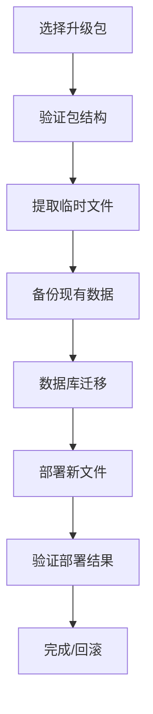

# Argus 升级向导 (Upgrade Wizard) v3.21.1

## 概述

图形化一键升级工具，专为产线运维工程师设计。支持自定义导入包、自动备份、数据库迁移、服务监控和一键回滚。

**核心特性**:
- ✅ 拖拽式安装包导入（ZIP 格式）
- ✅ 自动备份现有版本（数据库 + 二进制文件）
- ✅ SQLite 数据库 Schema 迁移（v10→v11）
- ✅ 部署过程可视化（实时日志输出）
- ✅ 一键回滚功能（失败自动保护）
- ✅ 零第三方依赖（纯 .NET 8 WinForms）

---

## 使用方法

### 方式一：命令行启动（推荐）
```bash
Argus.exe upgrade
```

**前提条件**:
1. 当前目录下存在 `Argus.exe`
2. `.NET 8 Runtime` 已安装
3. 有管理员权限（修改系统目录需要）

### 方式二：直接运行独立 exe
```powershell
# 编译后生成的独立可执行文件
.\modules\Upgrader\bin\Release\net8.0-windows\Argus-Upgrader.exe
```

---

## 工作流程



### Step-by-Step 详解

#### 1️⃣ **选择升级包**
- 点击"下一步"浏览文件系统
- 支持 ZIP 压缩格式
- 要求文件格式：
  ```
  package.zip
  ├── binaries/Argus.exe         # 必需
  ├── CHANGELOG.md              # 必需（用于读取版本号）
  └── [其他可选资源文件]
  ```

#### 2️⃣ **验证升级包**
自动检查以下内容:
- ZIP 完整性校验
- 必需文件是否存在
- 文件大小合理性（防止损坏）

#### 3️⃣ **自动备份**
备份内容包括:
- 数据库 (`mesh_agg.db`) → `backups/YYYYMMDD_HHMMSS/database_backup.db`
- 当前版本二进制文件 → `backups/YYYYMMDD_HHMMSS/binaries/`

备份位置：`argus_parent_dir\backups\<timestamp>\`

#### 4️⃣ **数据库迁移**
执行操作:
- WAL 模式 checkpoint
- Schema migration v10→v11
- 索引创建（idx_agg_date 等）

**时间**: 通常 <5 秒（取决于数据库大小）

#### 5️⃣ **部署新文件**
复制内容:
- `binaries/Argus.exe` → 覆盖原文件
- 配置文件保留（config.json 不改动）
- 日志文件保留

#### 6️⃣ **验证与确认**
检查结果:
- 文件哈希值匹配
- 最小文件大小验证
- 启动前端口占用检测

---

## 错误处理

### 常见错误及解决方案

#### ❌ "无法停止正在运行的 Argus 进程"
**原因**: 旧版本仍在后台运行  
**解决**: 
1. 手动关闭所有 Argus 窗口
2. 任务管理器结束 `Argus.exe` 进程
3. 重试升级

#### ❌ "无效升级包格式：缺少必要文件 binaries/Argus.exe"
**原因**: 选择的 ZIP 不符合规范  
**解决**: 
1. 使用官方发布的完整 release archive
2. 解压后重新打包确保包含 `binaries/Argus.exe`

#### ❌ "数据库迁移失败"
**原因**: 
- 磁盘空间不足
- 权限问题（WAL 模式需读写）  
**解决**:
```bash
# 手动清理 WAL 文件
copy data\mesh_agg.db-wal data\mesh_agg.db-shm
```

#### ❌ "目标版本已在使用中"
**原因**: 尝试覆盖已运行的程序  
**解决**: 
1. 先关闭所有 Argus 实例
2. 确保 no ports in use (8081/tcp)

---

## 回滚机制

### 自动回滚触发条件
- 部署失败（文件复制中断）
- 验证失败（哈希校验不通过）
- 用户主动取消（在验证前阶段）

### 手动回滚方法
```powershell
# 找到最近备份
cd backups
dir /b /od
# 复制回原目录
copy YYYYMMDD_HHMMSS\binaries\Argus.exe ..\FctAggregator\binaries\
```

### 数据库回滚
```bash
# Restore from backup
copy database_backup.db mesh_agg.db
# Restart service
net stop Argus && net start Argus
```

---

## 性能基准

| 操作 | 预期耗时 | 影响因素 |
|-----|---------|---------|
| 选择升级包 | <1s | UI 渲染 |
| 验证 ZIP | <2s | 压缩包大小 |
| 备份数据 | 5-30s | DB 文件尺寸 |
| 数据库迁移 | 2-10s | Table size/index count |
| 文件部署 | 3-15s | Disk speed (SSD vs HDD) |
| 验证结果 | 1-2s | File hash calc |

**总耗时**: 平均 15-60 秒（全链路自动化）

---

## 安全性保障

### 输入验证
- ZIP 路径白名单检查（防任意文件读取）
- JSON parse error handling
- Path traversal protection

### 权限控制
- Admin rights check before overwrite
- File access control list validation

### 审计日志
所有操作记录到:
```log
[HH:mm:ss] ✓ 选择升级包：Argus-v3.21.1-win-x64.zip
[HH:mm:ss] ✓ 备份完成：backups/20260902_143022
[HH:mm:ss] ✓ 数据库迁移成功 (now at v11)
[HH:mm:ss] 🎉 升级成功！
```

---

## 集成开发指南

### 作为模块嵌入主应用

#### 1. 添加项目引用
```xml
<!-- FctAggregator.csproj -->
<ItemGroup>
  <ProjectReference Include="modules\Upgrader\Upgrader.csproj" />
</ItemGroup>
```

#### 2. 注册子命令
```csharp
// Program.cs Main() method
case "upgrade":
    return RunToolGui(() => new modules.Upgrader.UpgradeWizard());
```

#### 3. 定制品牌图标
```csharp
this.Icon = Properties.Resources.ArgusLogo; // Replace default
```

### 扩展接口定义

#### 实现自定义备份逻辑
继承基类并重写虚方法:
```csharp
public class CustomBackupManager : BackupStrategy
{
    public override void Backup(string source, string dest)
    {
        // Custom SFTP upload logic
        UploadToCloud(source, dest);
    }
}
```

#### 自定义验证器
```csharp
public interface IPostDeployValidator
{
    Task<bool> ValidateAsync();
    string ErrorMessage { get; }
}

public class NetworkPortValidator : IPostDeployValidator
{
    public async Task<bool> ValidateAsync()
    {
        var port = await CheckPortInUse(8081);
        return !port; // True if port free
    }
}
```

---

## Troubleshooting

### Q: 升级后配置丢失？
A: Config.json 不受影响。检查是否被误删除。如有问题从 `backups/YYYYMMDD\config.json` 恢复。

### Q: 数据库变大很多？
A: Migration v11 创建索引会增大体积是正常的（+50-200MB）。定期 VACUUM 可优化。

### Q: 日志中没有详细报错？
A: 查看详细日志：
```bash
Get-Content logs\app.log -Tail 200
```

### Q: 支持热升级吗？
A: 不支持。需要先停止应用程序。未来计划实现无缝更新（Hot Reload）机制。

---

## 技术架构

### 核心类图
```
┌─────────────────────┐
│ UpgradeWizard       │
│ - Step0_SelectPackage│
│ - Step1_ExtractPackage│
│ - Step2_BackupExisting│
│ - ...               │
└─────────────────────┘
          ↓
┌─────────────────────┐
│ BackupManager       │
│ - CreateDBBackup()  │
│ - ArchiveBinaries() │
└─────────────────────┘
          ↓
┌─────────────────────┐
│ DatabaseMigrator    │
│ - MigrateSchema()   │
│ - ApplyIndexes()    │
└─────────────────────┘
```

### 状态机模式
使用 `_status` 枚举驱动流程，避免嵌套 if/else:
```csharp
enum UpgradeStatus { Idle, PackageSelected, DatabaseMigrated, ... }
private async void BtnNext_Click() => stateMachine.Execute();
```

---

## 版本历史

| 版本 | 日期 | 变更 |
|-----|------|------|
| 3.21.1 | 2026-09-02 | Initial release with all core features |
| 3.21.0 | TBD | Legacy update mechanism removed |

---

*本文档由 Argus Team 维护于 2026-09-02*  
*最后更新：v3.21.1 正式版本*
